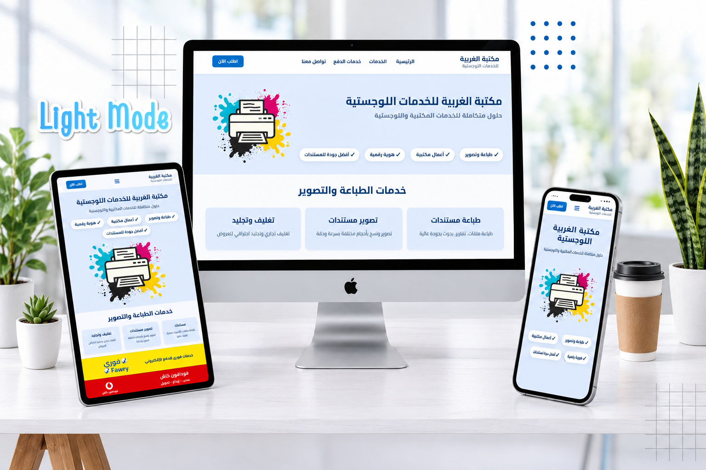
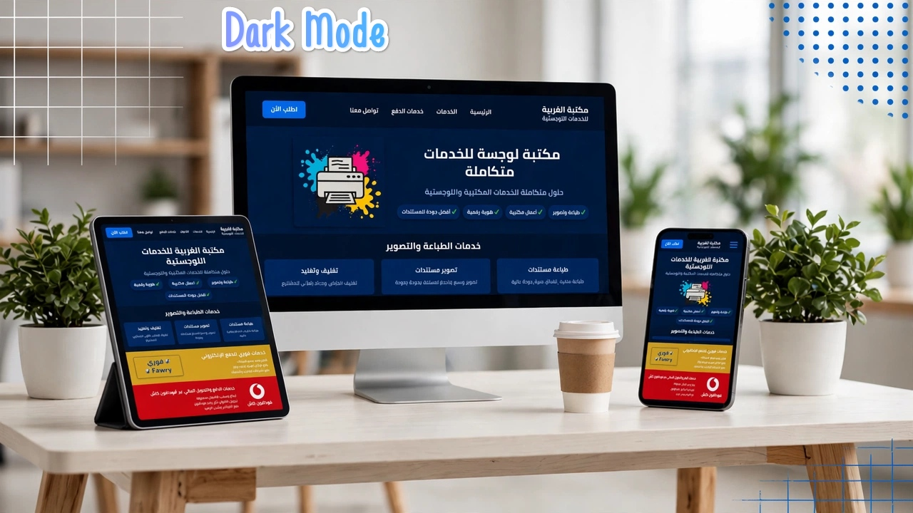

# Al-Gharbia Library for Logistics Services Landing Page

## Overview

This repository contains a static, responsive Arabic landing page for Al-Gharbia Library for Logistics Services, located in Tanta, Gharbia. The page presents the library's office, printing, copying, binding, and electronic payment services. It is designed as a single-page marketing website with right-to-left layout, mobile navigation, smooth anchor scrolling, and automatic dark mode based on the user's operating system preference.

The project is implemented using plain HTML, CSS, and JavaScript. It has no build step, package manager, framework, database, or backend dependency.

## Screenshots

### Light Mode


### Dark Mode


## Key Features

- Arabic right-to-left layout.
- Responsive design for desktop, tablet, and mobile.
- Fixed header with anchor navigation.
- Mobile hamburger navigation using a hidden checkbox and CSS state.
- Smooth scrolling to page sections with fixed-header offset handling.
- Automatic dark mode using `prefers-color-scheme`.
- Hero section with service highlights.
- Printing and photocopying services section.
- Fawry electronic payment services section.
- Vodafone Cash services section.
- Contact section with WhatsApp call-to-action.
- Working hours widget.
- Local Cairo font support.
- No external JavaScript or CSS frameworks.

## Tech Stack

- HTML5
- CSS3 with custom properties
- Vanilla JavaScript
- Responsive layout using CSS Grid and Flexbox
- Local font loading through `@font-face`
- Automatic color scheme support through `prefers-color-scheme`

## Project Structure

```text
.
├── index.html
├── css/
│   └── index.css
├── js/
│   └── index.js
├── fonts/
│   └── Cairo.ttf
├── images/
│   ├── real-printer.png
│   ├── printer.png
│   ├── fawry.png
│   └── vodafone-logo.png
└── LICENSE
```

## Getting Started

Clone the repository:

```bash
git clone https://github.com/your-username/al-gharbia-logistics-landing.git
```

Open the project directory:

```bash
cd al-gharbia-logistics-landing
```

Open `index.html` directly in a browser, or serve the directory using any static file server.

Example:

```bash
python3 -m http.server 8080
```

Then open:

```text
http://localhost:8080
```

No installation, compilation, or build command is required.

## Configuration and Customization

Most visual values are controlled through CSS custom properties in `css/index.css` under the `:root` selector. These include primary colors, background colors, card colors, text colors, border radius, shadows, and transition timing.

Content sections are defined directly in `index.html`. Text, service descriptions, contact information, and working hours can be edited there.

The WhatsApp contact link is defined in the footer using a `wa.me` URL. Update the phone number and prefilled message as required.

The project expects the Cairo font at `fonts/Cairo.ttf`. If the font path changes, update the `@font-face` rule in `css/index.css`.

Image assets are referenced from the `images/` directory. Ensure all referenced files exist before deployment.

## Page Sections

1. Header with logo, navigation, and primary call-to-action.
2. Hero section with main heading, service highlights, and printer image.
3. Printing and photocopying services section with three service cards.
4. Fawry electronic payment services section.
5. Vodafone Cash services section.
6. Footer containing contact information, WhatsApp link, working hours, and copyright notice.

## Responsive Behavior

The layout uses CSS Grid and Flexbox with media queries at `992px`, `892px`, `768px`, and `600px`. On smaller screens, the main navigation is replaced by a hamburger menu. Service cards and footer columns collapse into single-column layouts on narrow screens.

JavaScript handles anchor link clicks in the mobile navigation, closes the menu after selection, and scrolls to the target section while accounting for the fixed header height.

## Dark Mode

Dark mode is automatic and depends on the user's system preference through `prefers-color-scheme: dark`. There is no manual theme toggle. Some header and mobile navigation backgrounds are currently defined with light color values, so further refinement may be needed for complete dark mode consistency.

## Current Limitations

- The website is static and does not include a backend.
- Fawry and Vodafone Cash sections are informational only and are not integrated with payment APIs.
- The contact flow relies on a WhatsApp link.
- No contact form validation or form submission backend is included.
- No analytics, CMS, or deployment configuration is included.
- The CSS references a `--container` custom property that is not defined in `:root`; define it if a global container width is required.
- Some header and mobile navigation backgrounds use hardcoded light colors and may not fully follow the dark mode color scheme.

## Contact Information

Al-Gharbia Library for Logistics Services  
Gharbia, Tanta, behind the governorate  
WhatsApp: +20 114 858 9414

## License

This project is licensed under the MIT License. See the `LICENSE` file for details.
